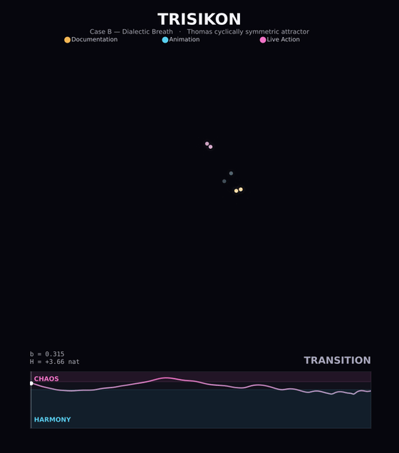

# TRISIKON

[](https://www.python.org)
[](https://numpy.org)
[](https://scipy.org)
[](https://peps.python.org/pep-0008/)
[](tests)
[](LICENSE)

A dynamical-systems and information-theoretic formalism for a tri-modal
compositional principle (TRISIKON: three situations and conditions). The
three modes, documentation, animation and live action, are mapped onto
the three cyclically symmetric axes of the Thomas flow, and a single
dissipation parameter drives the system between an ordered regime and a
chaotic one. The order-to-chaos dialectic is made quantitative and
comparable with the full Lyapunov spectrum, a nonparametric differential
entropy, the permutation complexity-entropy plane, and a group-theoretic
symmetry-breaking order parameter.

**Authors:** Sandy H. S. Herho, Sito F. Biosa, Rusmawan Suwarman, Dasapta E. Irawan

<p align="center">
  <br>
  <sub>Case B (Dialectic Breath). The three modes leave a long phosphor trail
  and a bright comet; the lower panel is the differential-entropy breathing
  between the shared harmony and chaos zones.</sub>
</p>

## Model

The state obeys the Thomas cyclically symmetric flow

```math
\dot x_1 = \sin x_2 - b_1 x_1,\qquad
\dot x_2 = \sin x_3 - b_2 x_2,\qquad
\dot x_3 = \sin x_1 - b_3 x_3,
```

which is equivariant under the cyclic permutation
$`x_1\to x_2\to x_3\to x_1`$ when the three dissipations are equal. Its
divergence is the constant $`-(b_1+b_2+b_3)`$, so the phase volume
contracts at a known rate and the Lyapunov exponents sum exactly to that
value. A raised-cosine schedule breathes the dissipation between an
ordered value and a chaotic one; a per-axis ratio breaks the symmetry.

The four cases share the seed, the ensembles, the period and the step,
so each difference is caused only by the dissipation range and the
symmetry ratio.

| case | name | dissipation range | ratio | reading |
|------|------|-------------------|-------|---------|
| A | Classical Order | 0.31 – 0.40 | 1 : 1 : 1 | ordered baseline |
| B | Dialectic Breath | 0.16 – 0.315 | 1 : 1 : 1 | full dialectic |
| C | Deconstruction | 0.115 – 0.22 | 1 : 1 : 1 | unresolved |
| D | Mode Dominance | 0.16 – 0.315 | 0.70 : 1.18 : 1.18 | one mode leads |

## Diagnostics

- **Lyapunov spectrum** by the Benettin method with QR reorthonormalization
  on the variational flow, with the Kaplan-Yorke dimension and, by the
  Pesin identity, the Kolmogorov-Sinai entropy rate. The numerical sum
  reproduces the exact rate $`-(b_1+b_2+b_3)`$ to about $`10^{-10}`$,
  which checks the whole spectrum.
- **Differential entropy** of the three-mode ensemble by both the
  Gaussian determinant (an upper bound at fixed covariance) and the
  Kozachenko-Leonenko k-nearest-neighbour estimator (nonparametric).
- **Permutation complexity-entropy plane** (Bandt-Pompe entropy and
  Martin-Plastino-Rosso statistical complexity), with the embedding delay
  set to one characteristic oscillation period and uncertainty from a
  segmental band. The attainable-region bounds use ordpy.
- **Symmetry breaking** as the coefficient of variation of the three
  ensemble-averaged axis energies, zero under cyclic symmetry.

The permutation entropy and statistical complexity are implemented from
scratch and validated against ordpy to machine precision; the Lyapunov
and entropy estimators are validated against closed forms in the tests.

## Figures

| | |
|---|---|
| `fig01_attractors` | phase portraits of the four cases |
| `fig02_lyapunov` | the Lyapunov spectrum and the exact sum rule along the dissipation axis |
| `fig03_complexity` | the four cases on the permutation complexity-entropy plane |
| `fig04_entropy` | the differential-entropy breathing and the symmetry-breaking order parameter |

## Usage

```bash
pip install -e .            # or: pip install -r requirements.txt
python scripts/run_all.py   # every figure, report, data file and animation
pytest                      # the validation suite
```

Heavy computations cache under `outputs/cache`; delete it to recompute.

## Layout

```
trisikon/        the library (dynamics, lyapunov, entropy, complexity,
                 symmetry, simulate, metrics, pipeline, plotting, anim)
scripts/         one script per figure, the reports and the animations
tests/           the validation suite
outputs/         figures (pdf, png), data (csv), reports (txt), animations
```

## License

MIT. Copyright (c) 2026 Applied Geology Research Group ITB. See
[LICENSE](LICENSE).

TRISIKON as a cinematic concept is taken from the collaborators'
description; its mapping to the Thomas flow is a formal analogy, not an
empirical claim about film practice.
